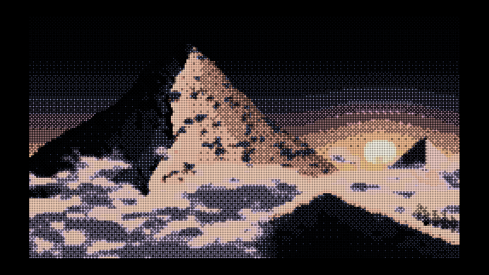

  

# 🏥 MedContinuum (CareContinuum)
### Autonomous Patient Healthcare Navigation & OPD Queue Radar

  <b>Eliminating blind travel and crowded waiting rooms through live hospital queue telemetry, geospatial satellite discovery, and secure diagnostic storage.</b>

[Explore Features](#-core-features) • [Architecture](#-architecture--tech-stack) • [Jammu Pilot Scope](#-jammu-pilot-dataset) • [Meet the Team](#-team-fix-fellas)

---

## 📌 Executive Summary

Patients from peripheral and rural regions often travel 40–50 km to tertiary healthcare centers (such as GMC Jammu) without knowing doctor availability, duty status, or live queue congestion. 

**MedContinuum** bridges this critical information gap:
- 🗺️ **Geospatial OPD Radar:** Discovers public hospitals and accredited private polyclinics using high-definition ESRI satellite imagery.
- ⏱️ **Live Duty Ledger & Dual-Engine Audio PA:** Live chamber states (In OPD, Ward Rounds, Emergency/OT) paired with a 3-tone airport/hospital chime (Web Audio API) and voice announcements (Web Speech API).
- 🩺 **Deterministic Clinical Triage:** A guided 4-step MCQ decision tree routing patients to the exact department and room number without hallucinations.
- 🔒 **Diagnostic Health Vault:** A zero-server, client-encrypted repository featuring mandatory test naming and native in-browser PDF/scan viewing.

---

## 🚀 Core Features

### 1. 🛰️ Geospatial OPD Radar
- **Zero-Watermark ESRI Satellite Layer:** Real-time aerial reconnaissance centered across Jammu healthcare clusters.
- **Department-Coded SVG Markers:** Custom pulsing radar pins categorizing Cardiology, Orthopaedics, Neurology, Paediatrics, ENT, and Dermatology.
- **Symmetrical Facility Ledger:** Clean, transparent cards showing verified OPD rooms, consultation timings, and fees (Free Govt vs. ₹500–₹800 Private).
- **Direct Dial & Focus:** Instant phone dialer for hospital helplines and bi-directional map coordinate centering.

### 2. 📢 Live Queue Telemetry & Hospital Voice PA
- **Digital OPD Tokens:** Generates instant queue numbers with dynamic patient count updates.
- **Acoustic PA Broadcast:** Replicates hospital public address announcements via browser-native audio synthesis:
  - Harmonic 3-tone chime (`D5` ➔ `A5` ➔ `E5`)
  - Natural text-to-speech room dispatch (*"Attention please. Token CRD-14, please proceed to Room 04, GMC Superspecialty"*)
- **My Live Tokens Hub:** Dedicated patient tab to track active numbers and replay audio callouts on demand.

### 3. 🧠 Clinical Decision Triage Wizard
- **Zero-Typing MCQ Navigator:** Guided 4-step decision tree (Age Bracket ➔ Anatomical Region ➔ Co-occurring Symptoms ➔ Department Conclusion).
- **Auto-Filter Integration:** Single click automatically filters the doctor directory and smoothly scrolls to the assigned consultation room.
- **Emergency Safeguard:** Automatically detects critical presentations (e.g., severe acute chest heaviness, trauma, stroke indicators) and overrides queues with urgent warnings to visit 24/7 Trauma Emergency centers.

### 4. 🗄️ In-App Diagnostic Health Vault
- **Validation Gate:** Requires explicit test report naming before upload, preventing lost, unlabeled files.
- **Native Document Viewer:** Directly renders actual uploaded medical PDFs and photo scans inside a client-side sandbox.
- **Demonstration Clinical Panels:** Pre-seeded with digitally verified pathology reports (Lipid Panel, HbA1c) showing reference ranges and abnormal flag alerts.
- **Client Sovereignty:** Runs entirely locally using Base64/LocalStorage with zero third-party cloud data transmission.

---

## 🛠 Architecture & Tech Stack
| Layer | Technologies |
| :--- | :--- |
| **Frontend Core** | Semantic HTML5, Vanilla JavaScript (ES6+), Modern Tailwind CSS |
| **Mapping Engine** | Leaflet.js, ESRI World Imagery Tile Services, ESRI Reference Boundaries |
| **Audio Synthesizer**| Web Audio API (Dual-Oscillator Sine Chime), Web Speech API (`SpeechSynthesis`) |
| **Document Engine** | HTML5 Canvas, FileReader API, Base64 Embedded PDF/Image Sandbox |
| **Micro-Interactions**| VanillaTilt.js (diffused perspective glow physics) |

---

## 📍 Jammu Pilot Dataset

The prototype includes pre-seeded verified facilities across Jammu district:

| Facility Name | Department | Sector | Room / Location |
| :--- | :--- | :--- | :--- |
| **GMC Superspecialty Wing** | Cardiology | Govt OPD | Room 04, Ground Floor |
| **GMC Main OPD Complex** | General Medicine | Govt OPD | Room 12, Medical Enclave |
| **GMC Trauma & Bone Hospital**| Orthopaedics | Govt OPD | Room 08, Maheshpura Chowk |
| **SMGS Hospital** | Paediatrics | Govt OPD | Room 03, Shalamar Road |
| **Govt Hospital Gandhi Nagar** | ENT & Emergency | Govt OPD | Room 02 & Room 07, Apsara Road |
| **Jammu Heart Care Clinic** | Cardiology | Private | Sector 3, Channi Himmat |
| **Spine & Joint Restoration** | Orthopaedics | Private | Canal Road, Talab Tillo |
| **DermaGlow Skin & Laser** | Dermatology | Private | Janipur Road, High Court |

---

## 👥 Team FIX FELLAS

<table align="center">
  <tr>
    <td align="center" width="25%">
      <a href="https://github.com/prityansjuj">
         
        <b>Prityanshu Jasrotia</b>
      </a> 
      <small>Lead Architecture & Full-Stack Systems</small> 
      <a href="https://github.com/prityansjuj"><code>@prityansjuj</code></a>
    </td>
    <td align="center" width="25%">
      <a href="https://github.com/vrindagupta-gh">
         
        <b>Vrinda Gupta</b>
      </a> 
      <small>Head of Research & Development</small> 
      <a href="https://github.com/vrindagupta-gh"><code>@vrindagupta</code></a>
    </td>
    <td align="center" width="25%">
      <a href="https://github.com/ishmeetsingh-gh">
         
        <b>Ishmeet Singh</b>
      </a> 
      <small>Healthcare Workflow & Strategy Lead</small> 
      <a href="https://github.com/ishmeetsingh-gh"><code>@ishmeetsingh</code></a>
    </td>
    <td align="center" width="25%">
      <a href="https://github.com/aakritisharma-gh">
         
        <b>Akriti Sharma</b>
      </a> 
      <small>UI/UX Designer & Presentation Lead</small> 
      <a href="https://github.com/aakritisharma-gh"><code>@aakritisharma</code></a>
    </td>
  </tr>
</table>

---

## 🚦 Roadmap

- [x] **Phase 1: Working Prototype** — ESRI map telemetry, browser audio PA chime/speech engine, 4-step triage wizard, in-app PDF vault.
- [ ] **Phase 2: Single-OPD Clinical Pilot** — Real-time staff roster updates, wait-time prediction benchmarking across 200+ patient encounters.
- [ ] **Phase 3: ABDM National Integration** — Synchronizing ABHA ID health lockers, and multilingual audio support in Dogri, Kashmiri, Hindi, and Urdu.

---

  Developed by <b>Team FIX FELLAS</b> for <b>IDEATHON 2026</b>.

